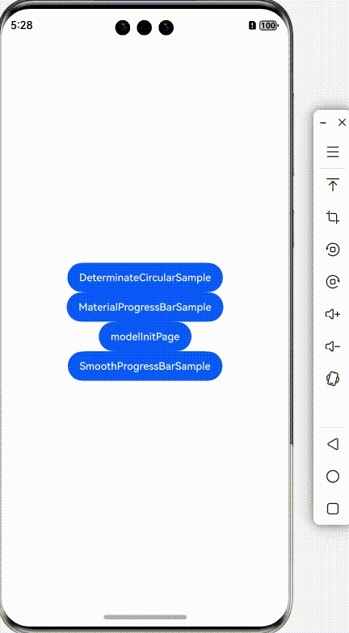
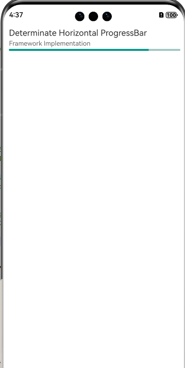

<div align="center">
<h1>progress-bar-cj</h1>
</div>

<p align="center">


</p>

## 介绍 

progress-bar-cj 是一个自定义ProgressBar效果，包含进度轮和水平柱两种效果。它是一个用仓颉语言编写的适用于鸿蒙系统的三方库。

<p align="left">

</p>

## 特性

- 提供material风格的进度轮进展条；
- 提供material风格的水平柱进展条；
- 提供smooth风格的进度轮进展条；
- 提供smooth风格的水平柱进展条：

### 源码目录

```shell
├─AppScope
├─doc            # API文档和使用手册存放目录                   
├─entry          # 示例代码文件夹                  
├─progressbar # progressbar 库源目录                  
│  └─src
│      └─main
│          ├─cangjie
│          │  └─src              # 核心实现功能代码                       
│          └─resources
├─hvigor     # 构建工具目录
├─README.md  # progress-bar-cj 介绍及使用说明
```
## 接口说明

主要类和函数接口说明详见 [API](doc/feature_api.md)

## 使用说明


### 编译构建

1. 源码编译

```shell
   1.下载源码 
   git clone https://gitcode.com/Cangjie-TPC/progress-bar-cj.git
   
   2.引用源码
   复制progressbar模块,粘贴到自身项目根级目录,并在cjpm.toml中添加依赖
   
    [dependencies.progressbar]
       path = "../../../../progressbar/src/main/cangjie"
       version = "1.0.0"
      
   3.使用源码
   import progressbar.*
   
```

2. har包编译

```shell
   1.下载源码 
   git clone https://gitcode.com/Cangjie-TPC/progress-bar-cj.git
   
   2.har包编译
   选中progressbar模块,点击 Build -> Make Module 'progressbar' 等待编译完成
   
   3.使用har包
   获取har包 progressbar\build\default\outputs\default\progressbar.har 复制到自身项目/libs下,并在oh-package.json5中添加依赖
     "dependencies": {
       "progressbar": "file:./libs/progressbar.har"
     }

   4.使用源码
   import progressbar.*
   
```

## 功能示例

详见 `entry`

#### 高亮引导组件示例

```cangjie
import progressbar.*       //导入依赖
import ohos.router.*
import ohos.base.*
import ohos.component.*
import ohos.state_manage.*
import ohos.state_macro_manage.*
import ohos.hilog.Hilog

@Entry
@Component
class MaterialProgressBarSample {
    var frameworkModel: MaterialModel = MaterialModel()

    protected override func aboutToAppear() {
        this.frameworkModel.setStyle(MaterialProgressStyle.MaterialHorizontal)
        this.frameworkModel.setProgress(30.0)
        this.frameworkModel.setSecondProgress(60.0)
        this.frameworkModel.setColor(0x009688)
        this.frameworkModel.setSecondColor(0x9fc6c2)
        this.frameworkModel.setBgColor(0xd7d7d7)
    }

    func build() {
        Column {
            Flex(FlexParams(direction: FlexDirection.Column)) {
                Text("Determinate Horizontal ProgressBar").fontSize(18).margin(2)
                Text("Framework Implementation").fontSize(14).fontColor(0x666666).margin(2)

                Flex(FlexParams(direction: FlexDirection.Column)) {
                    MaterialProgressBar(style: MaterialProgressStyle.MaterialHorizontal, modelBuild: this.frameworkModel
                    )
                }.height(20).width(100.percent).margin(2)
            }.width(100.percent).height(100.percent).padding(10)
        }.width(100.percent).height(100.percent).backgroundColor(Color.WHITE)
    }
}
```
<p align="left">

</p>

## 约束与限制
在下述版本验证通过：

    Cangjie Support Plugin 5.1.1.840

## 开源协议

本项目基于 [Apache License 2.0](./LICENSE)，请自由的享受和参与开源。

## 参与贡献

欢迎给我们提交 PR，欢迎给我们提交 Issue，欢迎参与任何形式的贡献。
